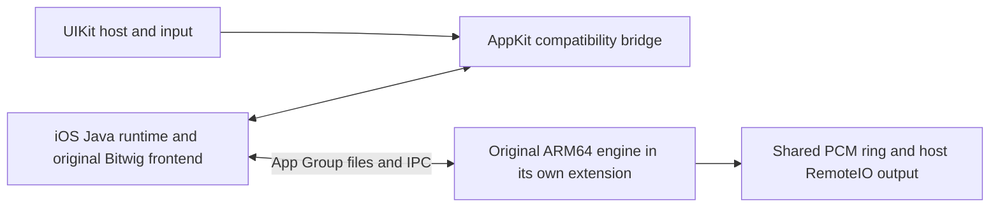

# Bitwig on iPad

An experimental, independent UIKit host for a locally supplied ARM64 Bitwig Studio installation. It runs adapted copies of the original frontend and audio engine with an iOS Java runtime. It is unaffiliated with Bitwig GmbH.

The repository contains development source. The build reads Bitwig and other binary dependencies from local installations, leaves the originals intact, and writes generated apps and diagnostics under ignored directories. The project’s original compatibility code is under MIT. Third-party components and materials retain their applicable terms. [License scope](LICENSE) · [Third-party notices](THIRD_PARTY.md) · [Bitwig terms](https://www.bitwig.com/terms-conditions/)

## How it works



The device host uses an embedded JIT helper with a trusted local developer pairing. The local tunnel is based on **LocalDevVPN by Stossy11 and the SideStore Team**. [Tunnel license and attribution](THIRD_PARTY.md)

## Verified scope

| Setup | Evidence |
| --- | --- |
| Physical iPad mini A17 Pro, Bitwig 6.1.4 | Original interface, Demo Mode, Poly Synth, clip playback, internal device drag and speaker output were exercised. The integrated JIT remains debugger-assisted. |
| ARM64 iPad Simulator, Bitwig 6.1.7 | Original Demo interface, editing, menus, touch recognition, gesture cancellation and engine loader startup were exercised. |
| Physical Bitwig 6.1.7 | Keyboard multitouch was confirmed hands-on. Independent contact release, matched chord PCM and active engine teardown remain unverified. |

Built-in microphone recording and simultaneous speaker output were verified on a physical iPad. External audio interfaces and live route switching remain unverified. Saving and exporting remain subject to Bitwig activation. Standalone post-reboot launch, third-party plug-ins and some file-picker paths remain unqualified. [Compatibility details and test commands](docs/compatibility.md)

## Build a Simulator host

Use an Apple-silicon Mac, Xcode with an ARM64 iPad Simulator runtime, Python 3.10+, and a macOS JDK for JNI headers. The current build was checked with Xcode 27.2. Supply a local ARM64 Bitwig Studio 6.1.4 or 6.1.7 app and a compatible iOS Java 25 runtime in `vendor/java25-ios`. The runtime directory needs `lib/`, `conf/`, and `release`. Set `BITWIG_JDK_HOME` to override `JAVA_HOME` and macOS JDK discovery. [Runtime provenance](THIRD_PARTY.md)

```sh
export BITWIG_APP="/path/to/Bitwig Studio 6.1.7.app"
python3 scripts/audit-native-port.py
python3 scripts/build-native-java-probe.py
python3 scripts/build-native-host.py
```

The builders print their output paths under `build/<version>/<source-key>/`. A running Simulator is required only to install or test the app. Use `python3 scripts/build-native-host.py --run --simulator <id>` to build, install and launch, or set `BITWIG_SIMULATOR_ID`. You can find local IDs with `xcrun simctl list devices`. The Simulator uses a neutral app identifier unless you set `BITWIG_BUNDLE_PREFIX`.

## Build for a development iPad

Device builds additionally require XcodeGen, a trusted iPad with Developer Mode enabled, the local helper inputs in [THIRD_PARTY.md](THIRD_PARTY.md), and Apple development signing with the required entitlements. The embedded packet tunnel uses the Network Extensions capability, which requires a supported paid program membership. The host and engine extension must both have access to the two registered App Groups. [Apple capability matrix](https://developer.apple.com/help/account/reference/supported-capabilities-ios/) · [App Group entitlement](https://developer.apple.com/documentation/BundleResources/Entitlements/com.apple.security.application-groups)

Set these variables locally for your own provisioning. The bundle suffixes for the app, engine, JIT helper and tunnel derive from one prefix. Keep the existing prefix and groups when updating an install.

| Variable | Purpose |
| --- | --- |
| `BITWIG_BUNDLE_PREFIX` | Your reverse-DNS prefix. The host is `<prefix>.nativehost`. |
| `BITWIG_DEVELOPMENT_TEAM` | Your Apple Developer team identifier. |
| `BITWIG_APP_GROUP` | Registered group for the shared project and audio data. |
| `BITWIG_IPC_GROUP` | Registered group for named semaphores, at most 14 characters including `group.`. |

```sh
python3 scripts/audit-native-port.py
python3 scripts/build-native-engine-probe.py --device
python3 scripts/build-native-host.py --device --embedded-tunnel --embedded-engine
```

Use the same `BITWIG_APP` and identity configuration for all three commands. The build does not install the app on an iPad. Provision trust and pairing for the device locally. The existing helper reads `Documents/pairing.plist` from the installed app. Keep pairing records, signing materials, logs, generated files, and proprietary assets outside tracked source.

## Projects and Master Recording

File → Save stores new projects in `BitwigUser/Projects` in the app's shared container. Reopen them from Recent Projects on the Bitwig Dashboard. Use the master meter's record button to capture the master output, and the adjacent folder button to open the project's `master-recordings` folder and preview the recording.

## Experimental Surge XT CLAP

Pass `--surge-clap "/path/to/Surge XT.clap"` to the iPad build with `--embedded-engine` to include a private copy of the supported Surge XT 1.3.4 desktop release. The build checks the original image, adapts its ARM64 slice, and signs it locally. In Bitwig Settings → Plug-ins, choose **with Bitwig** to use the audio engine's CLAP host. This build uses Bitwig's device parameters by default.

On a physical iPad, Bitwig reopened a saved Surge project with its MIDI clip and two edited macro values restored at Surge's saved precision. The original engine played the clip through the built-in speaker with zero reported output errors or underruns. The saved clip also played on AirPods in Bluetooth hands-free mode at 24 kHz hardware and 48 kHz client audio. A live switch to the iPad speaker and back to AirPods also reconnected the open project.

Run `python3 tests/surge-clap-probe.py --help` for the isolated Simulator check that reads the CLAP descriptor, changes and restores a parameter, and verifies note-on output and note-off release.

The opt-in `--surge-editor-clap-include /path/to/clap/include` build enables the original Surge editor. The engine renders the live plug-in instance and the foreground app relays touches from its editor panel. The same CLAP SDK include directory is used by `tests/surge-clap-probe.py --editor`, which checks isolated drawing, parameter edits, resizing, and cleanup alongside state and audio. Physical editor integration is experimental.

The same probe accepts `--chow-editor` with the official CHOW Tape Model 2.11.0 desktop CLAP to exercise the shared editor adapter with a second JUCE plug-in in Simulator. Add `--chow-clap "/path/to/CHOWTapeModel.clap"` to the same iPad editor build to package that release alongside Surge XT.

## Experimental Xfer OTT VST3

Pass `--ott-vst3 "/path/to/OTT.vst3"` to the build with `--device`, `--embedded-engine` and a supported local installation of Xfer OTT 1.3.1. The build adapts the original ARM64 executable, keeps the original editor resources and signs the private copy locally. In Bitwig Settings → Plug-ins, choose **with Bitwig**. Find OTT from Xfer Records under Audio FX and open its native editor from the device panel.

## Source checks

Run `python3 tests/local-config.py` for configuration validation and `python3 scripts/check-public-source.py` to check a committed snapshot for unexpected file types and common private-data patterns. The check reports categories only. It does not inspect external files or earlier history. Build artifacts and compatibility reports stay local. [Compatibility inventory, diagnostics, and targeted tests](docs/compatibility.md)
