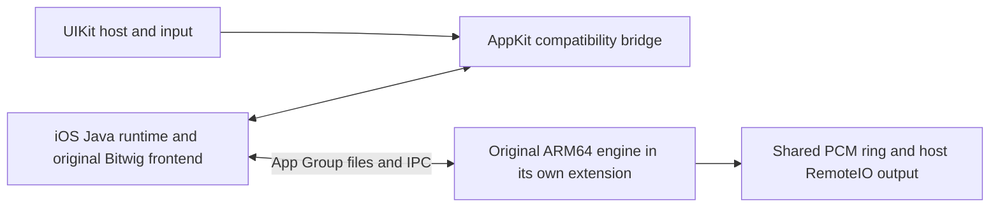

# Bitwig on iPad

An experimental, independent UIKit host for a locally supplied ARM64 Bitwig Studio installation. It runs adapted copies of the original frontend and audio engine with an iOS Java runtime. It is unaffiliated with Bitwig GmbH.

**Current implementation:** [`epic/6.1.7-multitouch`](https://github.com/curlcomplex/bitwig-ipad/tree/epic/6.1.7-multitouch). The default branch is an older implementation. Check out the current branch before running either build below.

```sh
git fetch origin
git switch epic/6.1.7-multitouch
```

The repository contains development source. The build reads Bitwig and other binary dependencies from local installations, leaves the originals intact, and writes generated apps and diagnostics under ignored directories. The project’s original compatibility code is under MIT. Third-party components and materials retain their applicable terms. [License scope](https://github.com/curlcomplex/bitwig-ipad/blob/epic/6.1.7-multitouch/LICENSE) · [Third-party notices](https://github.com/curlcomplex/bitwig-ipad/blob/epic/6.1.7-multitouch/THIRD_PARTY.md) · [Bitwig terms](https://www.bitwig.com/terms-conditions/)

## How it works



The device host uses an embedded JIT helper with a trusted local developer pairing. The local tunnel is based on **LocalDevVPN by Stossy11 and the SideStore Team**. [Tunnel license and attribution](https://github.com/curlcomplex/bitwig-ipad/blob/epic/6.1.7-multitouch/THIRD_PARTY.md)

## Verified on Bitwig Studio 6.1.7

| Area | Evidence |
| --- | --- |
| Touch and windows | The original onscreen keyboard was tested hands-on with multiple fingers on a physical iPad mini A17 Pro. The Simulator exercised independent finger release, scene-switch cancellation, and an Arranger radial-menu gesture. The main workspace fills the scene, and auxiliary dialogs preserve their own size. |
| Keyboard and mouse | Tested physical secondary click and Cmd+D clip duplication. Caps Lock toggles the original computer MIDI keyboard. A physical A key played and released a note when enabled and stayed quiet when disabled. |
| Audio and MIDI | Built-in microphone recording with simultaneous speaker output was verified. Audio through a Zoom U-44 was tested hands-on, and its MIDI ports appeared. MIDI data transfer remains untested. A saved clip also played over AirPods in hands-free mode, and a live switch to the speaker and back reconnected the open project. |
| Projects and recording | A saved, activated project reopened with its instrument and edited MIDI notes intact. The original Master Recording produced a WAV that remained available after reopening and played in Bitwig’s Preview Player. |
| Original plug-in editors | Scripted input on a physical iPad exercised the current opt-in builds of Surge XT, CHOW Tape Model, Xfer OTT, and Neural Amp Modeler. Parameter edits, Close Plug-in, project save and reopen, and audio playback were checked. NAM also restored a model and impulse response imported through its editor. |

The device launch is debugger-assisted and uses a trusted local developer pairing. Standalone launch after a reboot remains unverified. Project saving and exporting require the applicable Bitwig activation. [Compatibility details and test commands](https://github.com/curlcomplex/bitwig-ipad/blob/epic/6.1.7-multitouch/docs/compatibility.md)

## Build a Simulator host

Use an Apple-silicon Mac, Xcode with an ARM64 iPad Simulator runtime, Python 3.10+, and a macOS JDK for JNI headers. The current build was checked with Xcode 27.2. Supply a local ARM64 Bitwig Studio 6.1.4 or 6.1.7 app and a compatible iOS Java 25 runtime in `vendor/java25-ios`. The runtime directory needs `lib/`, `conf/`, and `release`. Set `BITWIG_JDK_HOME` to override `JAVA_HOME` and macOS JDK discovery. [Runtime provenance](https://github.com/curlcomplex/bitwig-ipad/blob/epic/6.1.7-multitouch/THIRD_PARTY.md)

```sh
export BITWIG_APP="/path/to/Bitwig Studio 6.1.7.app"
python3 scripts/audit-native-port.py
python3 scripts/build-native-java-probe.py
python3 scripts/build-native-host.py
```

The builders print their output paths under `build/<version>/<source-key>/`. A running Simulator is required only to install or test the app. Use `python3 scripts/build-native-host.py --run --simulator <id>` to build, install and launch, or set `BITWIG_SIMULATOR_ID`. You can find local IDs with `xcrun simctl list devices`. The Simulator uses a neutral app identifier unless you set `BITWIG_BUNDLE_PREFIX`.

## Build for a development iPad

Device builds additionally require XcodeGen, a trusted iPad with Developer Mode enabled, the local helper inputs in [THIRD_PARTY.md](https://github.com/curlcomplex/bitwig-ipad/blob/epic/6.1.7-multitouch/THIRD_PARTY.md), and Apple development signing with the required entitlements. The embedded packet tunnel uses the Network Extensions capability, which requires a supported paid program membership. The host and engine extension must both have access to the two registered App Groups. [Apple capability matrix](https://developer.apple.com/help/account/reference/supported-capabilities-ios/) · [App Group entitlement](https://developer.apple.com/documentation/BundleResources/Entitlements/com.apple.security.application-groups)

Set these variables locally for your own provisioning. The bundle suffixes for the app, engine, JIT helper and tunnel derive from one prefix. Keep the existing prefix and groups when updating an install.

| Variable | Purpose |
| --- | --- |
| `BITWIG_BUNDLE_PREFIX` | Your reverse-DNS prefix. The host is `<prefix>.nativehost`. |
| `BITWIG_DEVELOPMENT_TEAM` | Your Apple Developer team identifier. |
| `BITWIG_APP_GROUP` | Registered group for the shared project and audio data. |
| `BITWIG_IPC_GROUP` | Registered group for named semaphores, at most 14 characters including `group.`. |

```sh
python3 scripts/audit-native-port.py
python3 scripts/build-native-engine-probe.py --device
python3 scripts/build-native-host.py --device --embedded-tunnel --embedded-engine
```

Use the same `BITWIG_APP` and identity configuration for all three commands. The build does not install the app on an iPad. Provision trust and pairing for the device locally. The existing helper reads `Documents/pairing.plist` from the installed app. Keep pairing records, signing materials, logs, generated files, and proprietary assets outside tracked source.

For separately installed plug-ins, add the [independent plug-in runtime options](#install-plug-ins-separately-on-ipad) to the host build.

## Grid oversampling on Bitwig Studio 6.1.7

The optional Grid overlay adds an **DSP rate** choice to the device Inspector for supported Poly Grid, FX Grid and Note Grid patches. Select **1×** to run Grid DSP at the host sample rate, or **4×** for the original rate and default. The setting belongs to each device and is saved with the project. A patch containing a custom source the overlay cannot qualify keeps the stock 4× processing for the whole device. Unmodified Bitwig opens the project at its original rate and drops the overlay-specific setting on re-save.

Use **1×** when the sound suits the patch. Oscillators and nonlinear modules can alias more at the host rate. Algorithms with their own internal oversampling or HQ stages can retain that work. CPU usage depends on the patch. A small patch was benchmarked on iPad, and that measurement does not establish a general CPU saving.

On iPad, use the exact local ARM64 6.1.7 app and add `--grid-rate-overlay` to the device build with `--embedded-engine`. The host loads a separate class overlay before its copied Bitwig JAR. On macOS, the same six-class overlay can be prepared for a locally supplied Patchbay checkout at the pinned commit in the test instructions. Its native loader was checked headlessly. Desktop GUI validation is pending.

Physical iPad checks verified saved Poly Grid cold-open at 1× before opening the Inspector, live insertion of a stock module at 1×, wet FX Grid audio at 1×, and Note Grid output through a downstream Poly Grid at 1×. The source audit classified 233 stock module definitions and materialized 118 distinct transformed source inputs. Device checks exercised stock synchronous compiler results. Native module tests verified routing and controls for selected cases. [Grid test evidence and Patchbay setup](https://github.com/curlcomplex/bitwig-ipad/blob/epic/6.1.7-multitouch/tests/grid-rate/README.md)

## Projects and Master Recording

File → Save stores new projects in `BitwigUser/Projects` in the app's shared container. Reopen them from Recent Projects on the Bitwig Dashboard. Use the master meter's record button to capture the master output, and the adjacent folder button to open the project's `master-recordings` folder and preview the recording.

## Experimental original plug-in editors

### Install plug-ins separately on iPad

Build the host once with `--independent-plugins`, `--device`, `--embedded-engine`, and `--surge-editor-clap-include /path/to/clap/include`. This build ships the plug-in runtime and scanner without vendor plug-ins. In Bitwig Settings → Plug-ins, select **with Bitwig**.

On the Mac, prepare your locally installed supported plug-ins with the same Apple Development signing identity used for the host:

```sh
python3 scripts/prepare-plugins.py --library /Library/Audio/Plug-Ins \
  --output "$PWD/Prepared Plug-ins" --sign "Apple Development: Your Name"
```

You can also pass individual desktop bundle paths to the Mac preparer. Open Bitwig once, then open **Files → On My iPad → Bitwig → Plug-ins**. Copy each prepared package folder directly into **Plug-ins**, with its `Package.plist` and contents together. To remove a plug-in, delete its prepared folder in Files.

On the supported Bitwig 6.1.7 build, the browser refreshes the managed plug-in locations when you return to Bitwig. Other supported builds pick up folder changes at the next launch. Loaded plug-ins retain their current resources until the audio engine restarts. Existing prepared installs are copied into the Files folder once, so they can be managed there too. Preparing your existing library keeps the original plug-in identities for saved projects. Keep the vendor licenses required by those plug-ins.

### Plug-ins bundled in development builds

The following opt-ins use matching locally installed desktop plug-ins. In Bitwig Settings → Plug-ins, select **with Bitwig**.

Device builds register staged CLAP and VST3 plug-ins through stable discovery folders in the app group. The plug-in binaries remain in the signed app. Adding a plug-in requires a signed build with its opt-in below. The iPad Files picker handles editor assets such as Neural Amp Modeler models and impulse responses.

Editors open in floating panels, with the Arrangement usable around them. Drag the toolbar to move, drag the lower-right handle to resize the display, or use the toolbar buttons to go fullscreen, restore the previous floating size, or close.

### Surge XT and CHOW Tape Model CLAP

Pass `--surge-clap "/path/to/Surge XT.clap"` to the iPad build with `--embedded-engine` to include a private copy of the supported Surge XT 1.3.4 desktop release. The build checks the original image, adapts its ARM64 slice, and signs it locally. This build uses Bitwig's device parameters by default.

In the scripted iPad check, Surge’s original editor accepted Patch Browser text, opened its secondary-click menu, and dismissed the menu on Escape or an outside click. A Macro 1 drag updated Bitwig’s parameter and restored after project reopen. Surge’s original numeric **Edit Value** dialog updates the plug-in’s internal macro without sending the host notification that its drag path sends.

Run `python3 tests/surge-clap-probe.py --help` using the [Surge CLAP probe](https://github.com/curlcomplex/bitwig-ipad/blob/epic/6.1.7-multitouch/tests/surge-clap-probe.py) for the isolated Simulator check that reads the CLAP descriptor, changes and restores a parameter, and verifies note-on output and note-off release.

The opt-in `--surge-editor-clap-include /path/to/clap/include` build enables the original Surge editor. The engine renders the live plug-in instance and the foreground app relays touches from its editor panel. The panel routes hardware keys and secondary clicks to the original editor. Surge’s context menus stay within the editor panel at the same scale. The same CLAP SDK include directory is used by `tests/surge-clap-probe.py --editor`, which checks isolated drawing, parameter edits, resizing, and cleanup alongside state and audio. Physical editor integration is experimental.

The same probe accepts `--chow-editor` with the official CHOW Tape Model 2.11.0 desktop CLAP to exercise the shared editor adapter with a second JUCE plug-in in Simulator. Add `--chow-clap "/path/to/CHOWTapeModel.clap"` to the same iPad editor build to package that release alongside Surge XT.

### Xfer OTT VST3

Pass `--ott-vst3 "/path/to/OTT.vst3"` to the build with `--device`, `--embedded-engine` and a supported local installation of Xfer OTT 1.3.1. The build adapts the original ARM64 executable, keeps the original editor resources and signs the private copy locally. Find OTT from Xfer Records under Audio FX and open its native editor from the device panel.

### Neural Amp Modeler VST3

Pass `--nam-vst3 "/path/to/NeuralAmpModeler.vst3"` with `--device` and `--embedded-engine` to include the supported local Neural Amp Modeler 0.7.13 release. The build adapts the original ARM64 plug-in and compiles its matching upstream MetalNanoVG shader for iPadOS using the Xcode Metal toolchain. The original editor renders with Metal in the engine process and shares its completed frames with the foreground app. Its model and impulse response controls open the iPad Files picker. Selected `.nam` and `.wav` files are copied into the shared Bitwig user directory so saved projects can reopen them. The physical check presented the real Files picker and used scripted selection through its picker callback, then verified both assets after reopening the project.

### FabFilter CLAP

Add `--fabfilter-clap "/path/to/FabFilter Pro-Q 4.clap"` to a device build with `--embedded-engine`. Repeat the flag for each locally installed release you want to include. The [release table](https://github.com/curlcomplex/bitwig-ipad/blob/epic/6.1.7-multitouch/scripts/fabfilter_clap.py) lists the 22 supported bundle versions. Bitwig finds the private copies through its CLAP browser.

The iPad host uses FabFilter’s original software renderer because the supplied Metal libraries target macOS. The setting is applied only to the staged FabFilter binaries for this host. Plug-in authorization remains with FabFilter. [FabFilter graphics acceleration documentation](https://www.fabfilter.com/support/faq/18/how-can-i-disable-graphics-acceleration-on-my-computer)

On a physical iPad, all 22 releases completed one fresh Bitwig scan. Separate on-device checks opened each original editor and measured nonzero audio from each component. Scripted input in stock Bitwig exercised the floating editors for Pro-Q 4 and Twin 3. Pro-Q 4 restored the edited EQ bands after project reopen. The tested gesture created a new band at 0 dB, then a separate drag changed its gain with playback stopped. Twin 3 produced audio from its on-screen piano and restored its edited filter setting after project reopen. Its native Scaling menu changed the editor from 800 × 480 to 500 × 300 at 125%. The larger size presets were disabled by the plug-in in the tested layout.

## Source checks

Run `python3 tests/local-config.py` for [configuration validation](https://github.com/curlcomplex/bitwig-ipad/blob/epic/6.1.7-multitouch/tests/local-config.py) and `python3 scripts/check-public-source.py` to [check a committed snapshot](https://github.com/curlcomplex/bitwig-ipad/blob/epic/6.1.7-multitouch/scripts/check-public-source.py) for unexpected file types and common private-data patterns. The check reports categories only. It does not inspect external files or earlier history. Build artifacts and compatibility reports stay local. [Compatibility inventory, diagnostics, and targeted tests](https://github.com/curlcomplex/bitwig-ipad/blob/epic/6.1.7-multitouch/docs/compatibility.md)
